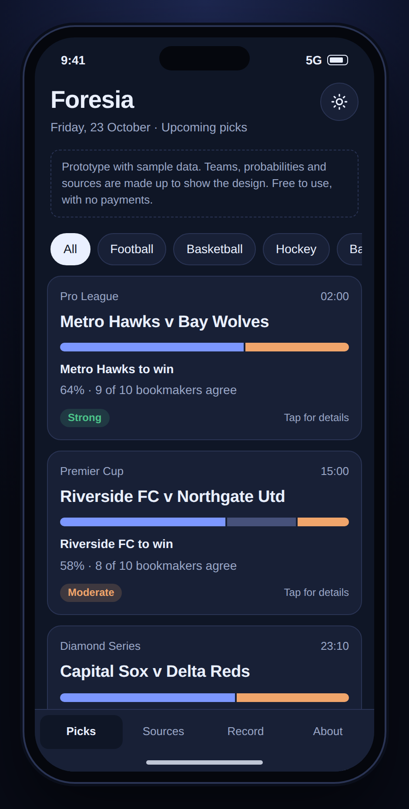
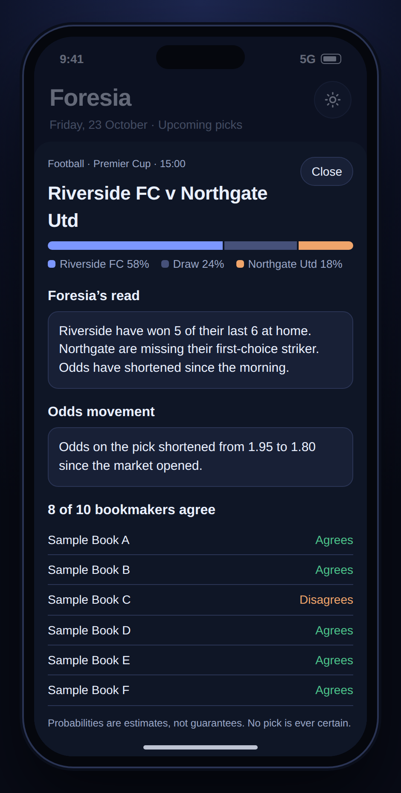
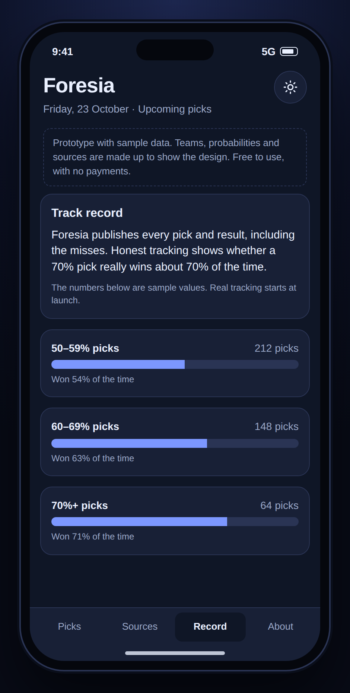
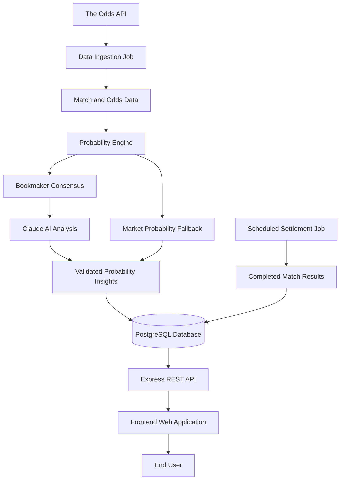

# Foresia — AI-Assisted Sports Probability Intelligence

**A Full-Stack Software Engineering Showcase by Nathaniel Emenike**

## Screenshots

| Dashboard | Match analysis | Performance |
|---|---|---|
|  |  |  |

*Screenshots use sample data to show the design. They are not real predictions.*
Foresia is an AI-assisted sports probability analysis platform designed to transform bookmaker odds into structured probability insights. It combines market-implied probabilities, bookmaker consensus, AI-assisted analysis, automated data processing, and historical result tracking in one application.

This public repository serves as a **software engineering portfolio showcase** of Foresia's architecture, technical approach, and engineering capabilities. The primary application repository is private, while this public repository documents the project's design, technology stack, features, and engineering decisions.

> **Project type:** Full-stack portfolio showcase  
> **Core application:** Private repository  
> **Developer:** Nathaniel Emenike  
> **Focus:** Backend Engineering, AI Integration, Data Processing, and Full-Stack Development

---

## Table of Contents

- [Project Overview](#project-overview)
- [The Problem](#the-problem)
- [Key Features](#key-features)
- [Technology Stack](#technology-stack)
- [System Architecture](#system-architecture)
- [How It Works](#how-it-works)
- [Engineering Decisions](#engineering-decisions)
- [API Design](#api-design)
- [Project Structure](#project-structure)
- [Local Development](#local-development)
- [Environment Configuration](#environment-configuration)
- [Deployment Architecture](#deployment-architecture)
- [Reliability and Limitations](#reliability-and-limitations)
- [Security Considerations](#security-considerations)
- [Roadmap](#roadmap)
- [About the Developer](#about-the-developer)
- [Contact](#contact)

---

## Project Overview

Sports odds contain information about how bookmakers assess the likelihood of different match outcomes. However, interpreting odds across multiple bookmakers can be difficult and time-consuming.

Foresia addresses this challenge through an automated workflow that collects bookmaker odds, calculates market-implied probabilities, measures bookmaker agreement, and uses the Claude API to generate constrained probability adjustments and concise explanations.

The platform also records completed match results, creating a foundation for evaluating historical performance over time.

### Project objectives

- Transform raw bookmaker odds into interpretable probability estimates.
- Measure agreement between bookmakers on match outcomes.
- Integrate AI into a controlled, data-driven analytical workflow.
- Automate recurring data collection, analysis, and result settlement.
- Expose structured insights through a REST API.
- Maintain historical records for performance evaluation.
- Demonstrate practical full-stack software engineering.

The primary engineering objective is to build a maintainable, data-driven application that integrates external APIs, AI services, background processing, persistent storage, and a web interface.

## The Problem

Raw odds are not direct probabilities, and comparing prices across multiple bookmakers requires additional processing.

Foresia addresses several related challenges:

1. **Odds interpretation:** Convert decimal odds into implied probabilities.
2. **Margin adjustment:** Account for the bookmaker margin when deriving market probabilities.
3. **Consensus measurement:** Determine how many bookmakers favour each outcome.
4. **AI-assisted analysis:** Use an AI model to evaluate the available numerical evidence within defined constraints.
5. **Automated evaluation:** Store completed results to support historical performance analysis.

The result is a structured analytical workflow rather than a collection of unsupported predictions.

---

## Key Features

### Automated Data Ingestion

Retrieves upcoming fixtures and bookmaker odds through The Odds API, reducing the need for manual data collection.

### Market-Implied Probability Calculation

Converts decimal odds into implied probabilities and removes the bookmaker margin to establish a market-based probability baseline.

### Bookmaker Consensus Analysis

Counts bookmaker preferences for available outcomes and measures the degree of agreement across the collected data.

### AI-Assisted Probability Analysis

Integrates the Anthropic Claude API to produce probability adjustments and concise explanations based on the supplied odds and bookmaker votes.

### Controlled AI Adjustments

Limits AI adjustments to a maximum of 10 percentage points per outcome relative to the market baseline.

### Graceful Fallback Handling

Falls back to market-derived probability estimates when AI analysis fails, reducing dependency on a single external service.

### Automated Result Settlement

Checks completed matches and records their outcomes for historical evaluation.

### REST API

Provides structured endpoints for retrieving probability insights, match details, source information, and historical performance summaries.

### PostgreSQL Persistence

Stores match information, bookmaker odds, analysis results, and settlement records.

### Scheduled Background Jobs

Separates recurring ingestion, analysis, and settlement operations from the user-facing application.

### Frontend Demo Mode

Supports sample data, allowing the frontend interface to be explored without a live backend connection.

---

## Technology Stack

| Layer | Technology | Purpose |
|---|---|---|
| Frontend | HTML5 | Application structure |
| Styling | CSS3 | Responsive interface and visual presentation |
| Client-side logic | Vanilla JavaScript, ES Modules | API integration and UI behaviour |
| Backend | Node.js 20+ | Server-side application logic |
| API framework | Express | REST endpoints and request handling |
| Database | PostgreSQL | Persistent application data |
| AI integration | Anthropic Claude API | AI-assisted probability analysis |
| Odds data | The Odds API | Fixtures and bookmaker odds |
| API architecture | REST | Communication between frontend and backend |
| Background processing | Node.js scripts | Scheduled data processing |
| Frontend hosting | Netlify | Static site deployment |
| Backend hosting | Render | API and scheduled jobs |
| Database hosting | Render PostgreSQL | Managed relational database |
| Version control | Git and GitHub | Source control and project documentation |

---

## System Architecture

Foresia separates the frontend, API, probability processing, AI integration, database, and scheduled jobs into distinct responsibilities.



### Architecture components

**1. Data provider**

The Odds API supplies fixture and bookmaker odds data.

**2. Ingestion layer**

Scheduled Node.js jobs retrieve and process incoming data.

**3. Probability engine**

The application converts odds into market-implied probabilities and accounts for bookmaker margin.

**4. Consensus analysis**

The system evaluates bookmaker preferences for the available match outcomes.

**5. AI analysis**

Claude receives the available numerical evidence and generates constrained probability adjustments with a short explanation.

**6. Persistence layer**

PostgreSQL stores the relevant match, odds, analysis, and result records.

**7. API layer**

Express exposes structured application data through REST endpoints.

**8. Frontend**

The static web application presents match information, probability insights, explanations, data sources, and historical records.

**9. Settlement process**

Scheduled jobs evaluate completed matches and save the resulting outcomes for historical analysis.

---

## How It Works

The processing pipeline follows seven main steps.

1. **Collect:** Retrieve upcoming fixtures and bookmaker odds from The Odds API.
2. **Calculate:** Convert decimal odds into implied probabilities and remove the bookmaker margin.
3. **Measure consensus:** Determine which outcomes bookmakers favour.
4. **Analyse:** Use Claude to generate constrained probability adjustments and concise explanations based on the supplied evidence.
5. **Validate and persist:** Apply the defined adjustment limits and save the analysis results.
6. **Serve:** Expose the processed information through the REST API for frontend consumption.
7. **Evaluate:** Settle completed matches and maintain historical performance records.

If AI analysis fails, the workflow can fall back to the market-derived probability estimates.

The AI component is designed to work with the available odds and bookmaker votes rather than inventing unsupported information about injuries, line-ups, or team news.

---

## Engineering Decisions

### 1. Separation of Concerns

The frontend, API, database operations, and scheduled jobs have distinct responsibilities.

This structure supports maintainability and makes it easier to extend individual components without unnecessarily coupling the entire application.

### 2. Market-Based Probability Estimation

Raw decimal odds are not treated as direct probabilities.

For decimal odds \(o_i\), the implied probability is:

\[
q_i = \frac{1}{o_i}
\]

For a market with \(n\) outcomes, a simple proportional margin adjustment is:

\[
p_i = \frac{q_i}{\sum_{j=1}^{n} q_j}
\]

This normalisation produces probabilities that sum to 1, or 100% when expressed as percentages.

The approach establishes a market-based baseline before AI analysis.

### 3. Controlled AI Adjustments

AI-generated estimates are constrained relative to the market baseline, with adjustments capped at 10 percentage points per outcome.

This helps limit the extent to which the model can change the initial estimates.

### 4. Graceful Degradation

The application can use market-derived probabilities when AI analysis fails.

This reduces dependence on a single external service and helps preserve the availability of analytical output.

### 5. Automated Background Processing

Data ingestion, analysis, and result settlement run as separate scheduled jobs.

This allows recurring operations to execute independently of user requests.

### 6. Historical Evaluation

Completed match results are stored to establish a basis for measuring actual performance over time.

This supports more transparent evaluation than presenting unverified accuracy claims.

### 7. Externalised Configuration

API credentials, database connections, CORS settings, and deployment-specific configuration are supplied through environment variables.

This separates sensitive configuration from application code.

---

## API Design

The backend exposes REST endpoints for application health, probability insights, match details, source information, and historical performance.

| Method | Endpoint | Purpose |
|---|---|---|
| `GET` | `/health` | Check API availability |
| `GET` | `/health/db` | Check database connectivity |
| `GET` | `/api/picks` | Retrieve insights for upcoming matches |
| `GET` | `/api/match/:id` | Retrieve detailed information for a specific match |
| `GET` | `/api/sources` | Retrieve prediction and odds source information |
| `GET` | `/api/record` | Retrieve historical performance summaries |

### Example response

The following JSON illustrates the general match data structure.

```json
{
  "id": 1,
  "sport": "Football",
  "league": "English Premier League",
  "kickoff": "2026-10-18T15:00:00.000Z",
  "home": "Team A",
  "away": "Team B",
  "p": [58, 24, 18],
  "odds": [1.95, 1.80],
  "agree": 8,
  "total": 12,
  "reason": "Illustrative probability explanation.",
  "sources": [
    {
      "name": "Bookmaker",
      "stance": "agree"
    }
  ]
}
```

**Note:** The response is illustrative and does not represent a live prediction or actual match record.

### Response field definitions

| Field | Description |
|---|---|
| `sport` | Sport associated with the match |
| `league` | Competition or league name |
| `kickoff` | Scheduled match start time |
| `home` | Home team |
| `away` | Away team |
| `p` | Outcome probabilities |
| `odds` | Representative odds values |
| `agree` | Number of bookmakers agreeing with the favoured outcome |
| `total` | Total bookmakers considered |
| `reason` | Short analytical explanation |
| `sources` | Bookmaker information and stance |

For three-outcome football markets, `p` represents home-win, draw, and away-win probabilities, respectively. The values should sum to 100. For sports without draws, the draw probability is represented as zero where applicable.

---

## Project Structure

The private application follows this high-level structure:

```text
foresia/
├── frontend/
│   └── Static web application
│
├── backend/
│   ├── Express REST API
│   ├── Data ingestion services
│   ├── Probability analysis
│   ├── Result settlement
│   └── Database integration
│
└── render.yaml
    └── Deployment blueprint
```

The public repository documents the project's architecture and capabilities without exposing the private application's implementation or production credentials.

---

## Local Development

The instructions below describe how the core application can be run in a development environment by someone who has authorised access to the private source repository.

### Prerequisites

- Node.js 20 or newer
- npm
- PostgreSQL
- An Anthropic API key
- A The Odds API key
- Git

### 1. Configure the backend

From the private project's root directory:

```bash
cd backend
npm install
cp .env.example .env
```

Configure the required environment variables in `.env`.

Run the database migration:

```bash
npm run migrate
```

Generate up to five picks:

```bash
npm run daily 5
```

Start the development server:

```bash
npm run dev
```

The API should be available at:

```text
http://localhost:4000
```

### 2. Verify the API

Check the following endpoints:

```text
http://localhost:4000/health
http://localhost:4000/health/db
http://localhost:4000/api/picks
```

The health endpoints help verify API availability and database connectivity.

### 3. Configure the frontend

In `frontend/js/api.js`, configure the API connection:

```javascript
const CONFIG = {
  useSample: false,
  baseUrl: 'http://localhost:4000'
};
```

From the project root, serve the frontend:

```bash
npx serve frontend
```

Configure `ALLOWED_ORIGIN` in the backend environment to match the exact frontend origin, including its port where applicable and without a trailing slash.

For example:

```text
ALLOWED_ORIGIN=http://localhost:3000
```

To explore the frontend without a backend connection, enable sample mode:

```javascript
const CONFIG = {
  useSample: true,
  baseUrl: 'http://localhost:4000'
};
```

These development instructions describe the private application and do not imply that its source code is included in this public showcase repository.

---

## Environment Configuration

The backend uses environment variables to manage application configuration and service credentials.

| Variable | Purpose |
|---|---|
| `PORT` | API port; defaults to 4000 |
| `DATABASE_URL` | PostgreSQL connection string |
| `DATABASE_SSL` | Controls database SSL configuration |
| `ALLOWED_ORIGIN` | Permitted frontend origins for CORS |
| `ANTHROPIC_API_KEY` | Anthropic API credential |
| `ANTHROPIC_MODEL` | Configured Claude model identifier |
| `ODDS_API_KEY` | The Odds API credential |
| `ODDS_REGIONS` | Bookmaker regions, such as `uk,eu` |

**Security rule:** Never commit `.env` files, private API credentials, production database URLs, or other secrets to GitHub.

---

## Backend Commands

The following commands are available in the private application's backend.

| Command | Purpose |
|---|---|
| `npm run dev` | Start the API with automatic restart |
| `npm start` | Start the API |
| `npm run migrate` | Create or update database tables |
| `npm run preview -- soccer_epl` | Preview odds for a specified sport without saving |
| `npm run ingest` | Ingest matches, odds, and bookmaker votes |
| `npm run analyse 20` | Analyse up to 20 matches |
| `npm run daily 60` | Ingest data and analyse up to 60 matches |
| `npm run settle` | Process completed matches and save results |

Commands should be run from the `backend/` directory. Exact behaviour depends on the implementation and configured services.

---

## Deployment Architecture

Foresia uses a deployment model that separates the frontend from server-side processing and data storage.

### Backend — Render

The backend deployment uses a Render web service, scheduled jobs, and PostgreSQL.

The deployment workflow is:

1. Push the authorised application source to its GitHub repository without committing secrets.
2. Create a Render Blueprint deployment using `render.yaml`.
3. Configure the required environment variables in Render.
4. Deploy the API and database resources.
5. Verify the `/health` and `/health/db` endpoints.
6. Trigger the daily job to begin the first data-processing cycle.

The scheduled jobs are configured in UTC. The current blueprint schedules result settlement at 05:00 UTC and daily ingestion and analysis at 06:00 UTC.

### Frontend — Netlify

The static frontend is designed for deployment on Netlify.

The general workflow is:

1. Connect the authorised repository to Netlify.
2. Set the base directory to `frontend`.
3. Configure the publish directory and build settings according to the frontend setup.
4. Configure the frontend API URL to point to the deployed backend.
5. Set the backend CORS allowlist to the deployed frontend origin.
6. Verify the application and its API integration.

Deployment availability and service behaviour depend on the configured hosting plans and external services.

---

## Reliability and Limitations

Foresia is an evolving engineering project, and its analytical output has important limitations.

- **Limited contextual data:** The AI analysis currently relies on odds and bookmaker votes rather than comprehensive team intelligence.
- **Historical sample size:** Early performance figures can be noisy and should not be treated as statistically conclusive.
- **Data quality:** Missing, delayed, or inconsistent external data can affect results.
- **Settlement differences:** Some competitions use extra-time scores while odds markets may refer to regulation time only.
- **External service dependency:** API outages, request limits, or changes in provider behaviour can interrupt processing.
- **Hosting limitations:** Free hosting tiers may have resource constraints, service interruptions, or data-retention limitations.
- **No guaranteed outcomes:** Probability estimates describe uncertainty and do not guarantee match results.

Historical performance should be evaluated over a sufficiently large and representative sample of settled matches before drawing conclusions about predictive accuracy.

---

## Security Considerations

Security is an important part of the application's design and deployment.

- Store credentials in environment variables or the hosting provider's secret-management facilities.
- Keep private application source code in its authorised repository.
- Restrict cross-origin requests through appropriate CORS configuration.
- Protect operational endpoints that can trigger background jobs.
- Avoid exposing internal errors, secrets, or sensitive infrastructure details in public API responses.
- Use database connection security appropriate to the deployment environment.
- Review external data provider terms before redistributing odds or related information.

This public repository is a documentation and portfolio showcase. It should not contain credentials, private source files, database dumps, or other confidential application assets.

---

## Compliance and Responsible Use

Foresia is an informational sports probability analysis project.

- It is not a betting platform and does not accept wagers.
- It does not guarantee match outcomes or financial returns.
- Probability estimates should not be presented as certain or risk-free results.
- Any public deployment should retain appropriate informational and age-related notices.
- Applicable laws, data licensing conditions, and platform policies should be reviewed before expanding the product or its distribution.

---

## Roadmap

Planned areas for future development include:

- Integrating additional licensed and permitted prediction data sources.
- Incorporating verified team news, injuries, and line-up information.
- Improving probability calibration and historical evaluation.
- Adding access-controlled endpoints for authorised manual job execution.
- Expanding monitoring, testing, and operational resilience.
- Exploring Android and iOS delivery options.
- Developing support and product features after reviewing applicable platform and payment requirements.

These items represent development goals rather than claims that the features have already been implemented.

---

## About the Developer

**Nathaniel Emenike — Software Engineer**

I build software that combines backend engineering, API integration, data processing, AI services, and practical frontend development.

Foresia demonstrates my approach to solving an end-to-end engineering problem: collecting data from external services, transforming it into structured insights, persisting results, exposing them through an API, and delivering them through a web application.

### Technical Interests

- Backend development with Node.js and Express.
- REST API design and third-party integrations.
- PostgreSQL and relational data modelling.
- AI integration and constrained model outputs.
- Automation and scheduled background processing.
- Full-stack application architecture.
- Deployment, reliability, and maintainable software design.

### What Foresia Demonstrates

The project showcases my ability to work across multiple software engineering layers:

- Designing a full-stack application architecture.
- Integrating third-party APIs and AI services.
- Building backend services and REST endpoints.
- Working with relational databases and persistent records.
- Automating data-processing workflows.
- Handling external service failures with fallback behaviour.
- Planning deployment across frontend, backend, database, and scheduled jobs.
- Documenting technical decisions and project limitations.

The core application repository is private. This public repository communicates the project's technical scope and architecture without exposing the private implementation.

---

## Contact

I welcome opportunities to discuss software engineering, backend development, AI integration, and full-stack application development.

**GitHub:** [github.com/Githubnath](https://github.com/Githubnath)

**LinkedIn:** [Nathaniel Emenike](https://www.linkedin.com/mwlite/in/nathaniel-emenike)

**Primary Email:** [emenike.nathaniel@gmail.com](mailto:emenike.nathaniel@gmail.com)

**Alternative Email:** [emenikenathaniel55@gmail.com](mailto:emenikenathaniel55@gmail.com)

**WhatsApp:** [+234 703 544 5571](https://wa.me/2347035445571)

### For Recruiters and Hiring Managers

I am interested in opportunities where I can contribute to building reliable, maintainable, and practical software solutions.

If you would like to discuss my engineering experience, the architecture behind Foresia, or my approach to solving technical problems, feel free to contact me through LinkedIn, GitHub, or email.

---

*Foresia — turning bookmaker market data into structured probability insights.*

**Built and documented by Nathaniel Emenike.**
